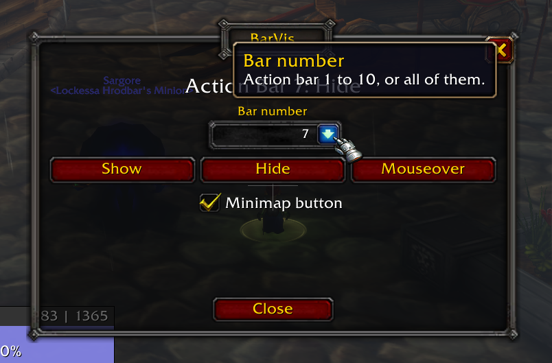

# BarVis

Show, hide or mouseover any EllesmereUI action bar from a small window, a key binding or one chat command, instead of digging through EllesmereUI's options every time.

**[Download BarVis](https://github.com/msromike/BarVis/releases/latest/download/BarVis.zip)** (latest release, ready to unzip into `Interface\AddOns`)

BarVis changes the same Visibility setting as the dropdown in EllesmereUI's Action Bars options, so the change sticks across reloads and shows up there too.

## Requires

- **WoW Forever.** Tested on Forever only. It may well work wherever EllesmereUI runs, but that's untested, so other clients list BarVis as out of date.
- **EllesmereUI with its Action Bars module.** Tested on EllesmereUI 9.6.1.

## Install

1. **[Download BarVis.zip](https://github.com/msromike/BarVis/releases/latest/download/BarVis.zip)**, the latest release. Older versions are on the [Releases](https://github.com/msromike/BarVis/releases) page.
2. Unzip it into your Forever install's `Interface\AddOns` folder, so you end up with `AddOns\BarVis\BarVis.toc`.

Don't use the green **Code > Download ZIP** button: it names the folder `BarVis-main`, and WoW won't load an addon under that name.

## Using it

- **The window.** `/barvis` opens it. Pick a bar (1 to 10, or All) from the dropdown, then click Show, Hide or Mouseover. The line at the top shows that bar's current setting; with All it shows the one setting every bar shares, or "mixed". The checkbox at the bottom shows or hides the minimap button.
- **A key.** Escape > Options > Key Bindings > BarVis > Toggle BarVis window. The key opens the window and closes it again.
- **The minimap button.** Click to open or close the window. Also available to broker display addons as "BarVis".
- **From chat or a macro.** `/barvis hide 10`, or `/barvis hide all` for bars 1 to 10 at once.

In combat, EllesmereUI holds the change until combat ends.

## Commands

| Command | What it does |
|---|---|
| `/barvis` | Opens the window |
| `/barvis help` | This list (`/barvis ?` does as well) |
| `/barvis show N` | Always show bar N |
| `/barvis hide N` | Hide bar N |
| `/barvis mouseover N` | Show bar N only on mouseover |
| `/barvis gui` | Opens the window too |

N is a bar number from 1 to 10, or `all` for every bar. Tab autocompletes both words in chat: the command, then the bar number or `all`. The minimap button setting is shared by every character on the account.

## What can break it

BarVis doesn't draw or hide bars itself. It calls the same code EllesmereUI's own Visibility dropdown calls, all of it in one file, `Modules/Bridge.lua`. If an EllesmereUI update renames that code, BarVis stops changing bars and says "EllesmereUI Action Bars is not loaded." until BarVis is updated. It never touches any EllesmereUI setting other than each bar's visibility.

If it stops working after an EllesmereUI update, [open an issue](https://github.com/msromike/BarVis/issues) and say which EllesmereUI version you're on. A PR is welcome too.

## License

MIT, see [LICENSE](LICENSE).

Bundles Ace3 (BSD-style), LibDBIcon, LibDataBroker and LibStub. Each keeps its own license.
